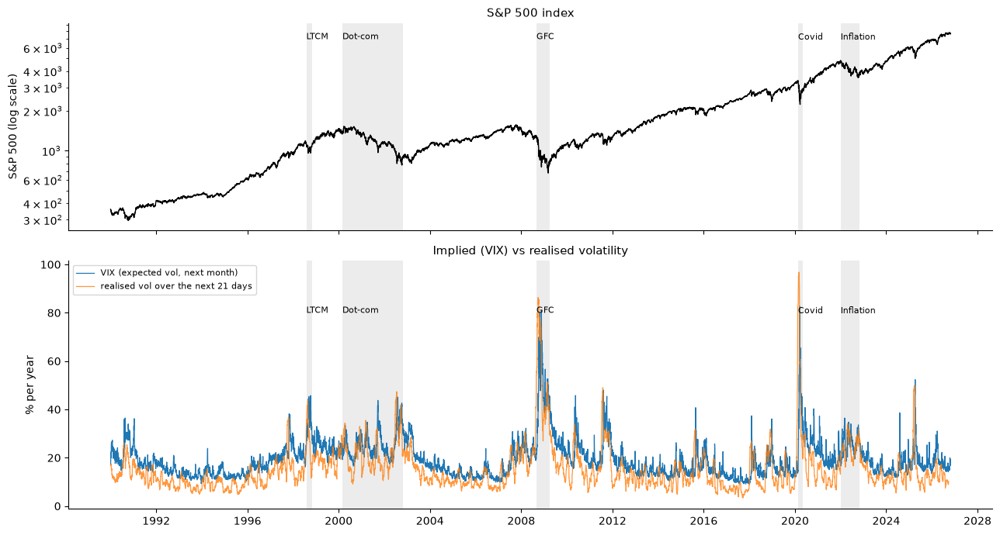
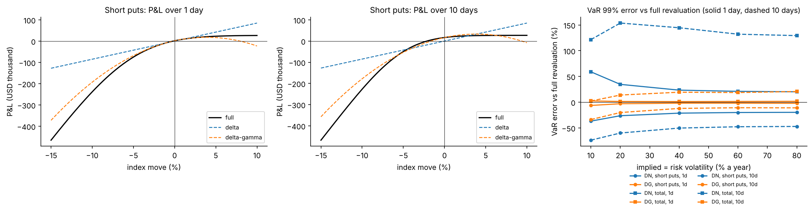
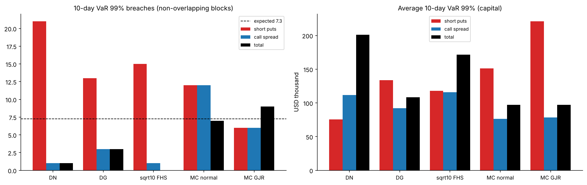
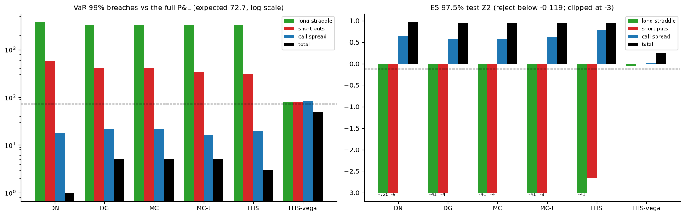
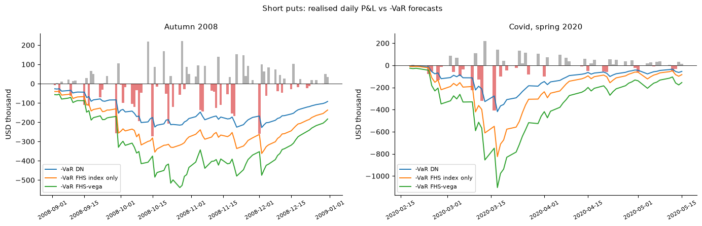

# Options Portfolio VaR: Delta-Normal vs Delta-Gamma vs Monte Carlo

**How should a risk team measure the Value-at-Risk of a book of index options, and how wrong are linear (delta-normal) approximations for non-linear positions?**

This project measures the risk of a **book of one-month S&P 500 options** — a **long ATM straddle**, **short 95% puts** and an **ATM/105% call spread**, USD 5m of index notional per 10 contracts, priced with Black–Scholes at the VIX and rebuilt daily — from **1990 to 2026**. Everything is implemented from scratch in Python: Black–Scholes prices and Greeks, the book and its realised P&L, VaR/ES by delta-normal, delta-gamma (Cornish–Fisher and exact), Monte Carlo with full revaluation (normal and Student-t), filtered historical simulation (FHS), a **GJR-GARCH-t** extension for 1-day and 10-day risk, and **joint index + VIX scenarios for vega risk**, all backtested out of sample over **8,268 days (December 1993 – October 2026)**.

Methods follow J. Daníelsson, *Financial Risk Forecasting* (Wiley, 2011), Chapters 6–7, applied to current data.

---

## Executive summary

| | Result |
|---|---|
| **Delta-normal is wrong in both directions** | One day: **−26%** for the short puts, **+35%** for the whole book. Ten days: **2.9× too low** for the short puts, **2× too high** for the book. Short puts: 264 breaches vs 82.7 expected. |
| **Delta-gamma** | Within 1–6% of full revaluation on one day; **−34% to +21%** at ten days. Cornish–Fisher can give a negative VaR. |
| **The tail matters more than the valuation (1 day)** | DG and normal Monte Carlo fail almost identically (~170 breaches); historical (FHS) scenarios are needed. |
| **GJR-GARCH extension** | **FHS with GJR volatility passes Kupiec, Christoffersen and Z2 for every book** (81 / 81 / 83 breaches vs 72.7), with 2–6% less capital than EWMA. At 10 days only **Monte Carlo along GJR-t paths** passes; √10 × FHS is half too low for the short puts. |
| **Vega is the largest risk** | **Joint FHS of index and VIX moves passes all tests against the real P&L**; capital changes ×4.8 (straddle), +60% (short puts), −23% (call spread), −31% (book). |
| **Crises** | Short puts, autumn 2008 / spring 2020: delta-normal breached 9 / 9 times, FHS-vega 2 / 1. |

---

## Data and design

- **Index:** S&P 500 price index (Yahoo Finance `^GSPC`). **Implied volatility:** VIX / 100 (FRED `VIXCLS`), flat across strikes. **Rate:** 3-month T-bill (FRED `DGS3MO`), last known value. **Dividend yield:** 1.5%.
- **9,269 common days** (2 January 1990 – 26 October 2026).
- **Book:** one-month options rebuilt every day at constant moneyness; contracts scaled daily to USD 5m notional per 10 contracts.
- **P&L:** clean (hypothetical) P&L — yesterday's options revalued today — in two versions: **full** (index, VIX, rate move) and **index-only** (VIX held).
- **Risk volatility:** EWMA (λ = 0.94), then GJR-GARCH-t re-estimated every 20 days on 1,000 days. The VIX prices the options; it is not used as the risk forecast (it carries the variance risk premium).
- **Out of sample:** every forecast for day *t* uses data up to *t − 1* only, verified with fake-crash and fake-VIX-spike look-ahead tests.

---

## Results

### 1. Market data



VIX averaged 19.4 against 15.4 realised (above it on 85% of days) but was 69 points below it at the start of the Covid crash. Index return and VIX change: correlation −0.71; VIX rose on 99% of the index's 1% worst days.

### 2. Approximations vs full revaluation



| VaR error vs full revaluation | Short puts DN | Short puts DG | Book DN | Book DG |
|---|---|---|---|---|
| 1 day, σ 20% | −26% | −3% | +35% | +1% |
| 10 days, σ 20% | −60% | −20% | +154% | +14% |

### 3. Out-of-sample backtests (index-only P&L, GJR period, 72.7 breaches expected)

| Short puts | Breaches | Kupiec p | Christoffersen p | Z2 (reject < −0.119) |
|---|---|---|---|---|
| Delta-normal (GJR vol) | 204 | 0.000 | 0.000 | −1.27 ✗ |
| Monte Carlo normal | 120 | 0.000 | 0.000 | −0.55 ✗ |
| Monte Carlo Student-t | 90 | 0.049 | 0.143 | −0.29 ✗ |
| FHS (EWMA vol) | 81 | 0.335 | 0.032 | −0.03 ✗ |
| **FHS (GJR vol)** | **81** | **0.335** | **0.378** | **−0.00 ✓** |

### 4. Ten-day risk (726 non-overlapping blocks, 7.3 breaches expected)



### 5. Vega: all methods against the full realised P&L



| Breaches (72.7 expected) | DN | DG | MC | MC-t | FHS | **FHS-vega** |
|---|---|---|---|---|---|---|
| Long straddle | 3,729 | 3,313 | 3,322 | 3,322 | 3,323 | **80** |
| Short puts | 585 | 419 | 406 | 339 | 309 | **80** |
| Call spread | 18 | 22 | 22 | 16 | 20 | **83** |
| Total | 1 | 5 | 5 | 5 | 3 | **50** |



---

## Recommendation

- **Daily VaR / ES:** full revaluation on joint index and implied-volatility scenarios (FHS) with GJR-GARCH volatility — never delta-normal.
- **10-day / regulatory horizon:** Monte Carlo along GARCH paths with full revaluation, not √10.
- **Greeks:** for understanding and hedging, not as the risk measure. **Validate against the full P&L**, not an index-only P&L.

**Limitations:** one flat implied volatility (no skew); model-based realised P&L; constant dividend yield; stylised daily-rolled book; low power of 10-day tests; procyclical capital.

---

## Repository

```
options-portfolio-var/
├── data/raw/                       downloads (spx.csv, vix.csv, dgs3mo.csv)
├── data/processed/                 market data, P&L, GJR forecasts, out-of-sample VaR/ES
├── notebooks/01_options_var.ipynb  the analysis, Sections 1-10
├── notes/theory.md                 equations, definitions, worked examples
├── reports/                        Project6_Report.docx, Project6_Theory_Notes.docx, figures/
├── src/optionsvar/                 data, pricing, book, volatility, var_methods, garch,
│                                   engine, backtest, plots
└── tests/test_optionsvar.py        30 unit tests (no internet needed)
```

## How to run

```bash
conda create -n quant python=3.11
conda activate quant
pip install -r requirements.txt
pytest -v                                 # 30 tests
jupyter lab notebooks/01_options_var.ipynb
```

The first run downloads the data (`data/raw`) and computes the out-of-sample runs (about 15 minutes in total); later runs reload them from `data/processed`.

## Reference

Daníelsson, J. (2011). *Financial Risk Forecasting: The Theory and Practice of Forecasting Market Risk with Implementation in R and Matlab.* Wiley.
